# DSO202 — Practical 5 Report
## Environment-Specific Configuration with Kustomize on Kind

---

## 1. Objective

This practical manages one application across several environments with **Kustomize**, the configuration tool built into `kubectl` (`kubectl kustomize`, `kubectl apply -k`). A single **base** describes the application once. Small **overlays** describe only how each environment differs. No Deployment or Service manifest is ever copied.

The workload is a small NGINX web server. The learning target is Kustomize, not application code. The practical works through these stages on a three-node `kind` cluster:

1. Pre-flight: cluster, nodes and `kubectl` Kustomize support
2. Reading the repository: what is shared and what differs
3. Rendering the base and finding the generated ConfigMap hash
4. Comparing dev and prod offline, without touching the cluster
5. Deploying dev with the safe workflow `render → diff → apply → verify`
6. Reaching the application through `port-forward`
7. Proving the chain from a ConfigMap hash change to a rollout
8. Deploying staging and prod
9. Inspecting what the prod strategic-merge patch changed
10. Building my own QA overlay with a JSON 6902 patch
11. Cleanup
12. Challenge extension: a `namePrefix` sandbox overlay

---

## 2. Environment

| Component | Value |
|---|---|
| Host OS | Kali GNU/Linux Rolling, kernel `7.1.5+kali-amd64` |
| Container runtime | Docker Engine `29.9.2` (native daemon, `/var/run/docker.sock`); nodes report `containerd://2.3.1` |
| kind | `v0.32.0`, 3-node cluster `dso202-p5` created from `cluster/kind-cluster.yaml` |
| Kubernetes | `v1.36.1` (node image `kindest/node:v1.36.1`) |
| kubectl | Client `v1.36.5` with embedded **Kustomize `v5.8.1`** |
| Application image | `nginx:1.27-alpine` (base); `nginx:1.28-alpine` (prod, through the `images` transformer) |
| Namespaces | `webapp-dev`, `webapp-staging`, `webapp-prod`, `webapp-qa` (one per overlay); `webapp-sandbox` (render only) |

The kubeadm node-name patches in `cluster/kind-cluster.yaml` applied correctly. `kubectl get nodes` returned `control-plane`, `worker-node-1` and `worker-node-2`, which matches the lab topology.

**Note on cluster creation:** the first `kind create cluster` attempt failed. The kubelet on a worker node did not become healthy in time (`kubelet-wait-bootstrap ... context deadline exceeded`), because the host was already busy running other containers. A second attempt with the same configuration succeeded. Its log is kept in `evidence/kind-create-cluster.txt`.

### Repository layout

```
DSO202-Practical-05/
├── README.md                     ← this report
├── cluster/kind-cluster.yaml     ← 3-node kind cluster (dso202-p5)
├── examples/webapp/
│   ├── base/                     ← deployment, service, index.html, kustomization
│   └── overlays/
│       ├── dev/  staging/  prod/ ← lab overlays
│       ├── qa/                   ← Task 9 (my own overlay, JSON 6902 patch)
│       └── sandbox/              ← challenge extension (namePrefix)
├── evidence/                     ← full rendered YAML, full diff, final state
└── screenshots/                  ← terminal evidence used below
```

---

## 3. Procedure and Observations

### Task 0 — Pre-flight

```
kubectl cluster-info
kubectl get nodes -o wide
kubectl version --client -o yaml
```

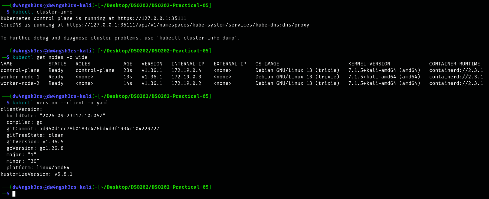

**Observation:** the current context (`kind-dso202-p5`) reaches the control plane. All three nodes are `Ready` on `v1.36.1`. The client reports `kustomizeVersion: v5.8.1`, so `kubectl kustomize` and `-k` work without installing a separate `kustomize` binary.

### Task 1 — Read the repository before running it

```
tree examples/webapp
```

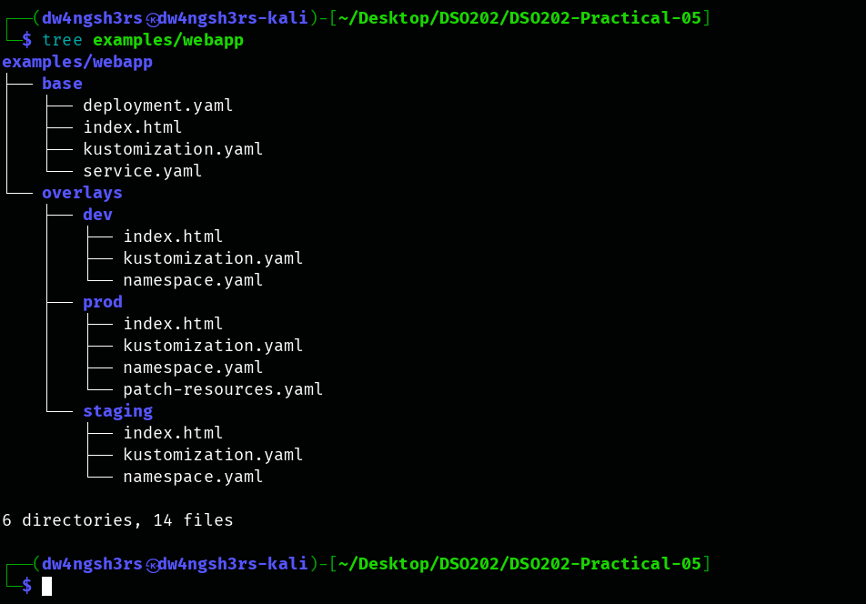

The base holds the complete application. Each overlay holds only a `kustomization.yaml`, its own `namespace.yaml` and its own `index.html`. Prod also has one patch file.

1. **Which files exist only once for all environments?** `base/deployment.yaml`, `base/service.yaml`, `base/kustomization.yaml` and the default `base/index.html`. The Deployment and Service exist in exactly one place.
2. **Which values differ between environments?** The namespace, the `environment` label, the replica count (1 / 2 / 3), the image tag (prod only), the container resources (prod only), the web page content, and the `training.example.com/stage` annotation.
3. **Where are those differences represented?** In each overlay's `kustomization.yaml` (`namespace`, `labels`, `replicas`, `images`, `configMapGenerator` with `behavior: replace`, `commonAnnotations`). Also in the overlay's `index.html`, and for prod in `patch-resources.yaml`.

### Task 2 — Render the base

```
kubectl kustomize examples/webapp/base | grep '^kind:'
kubectl kustomize examples/webapp/base | grep 'name: web-content'
```

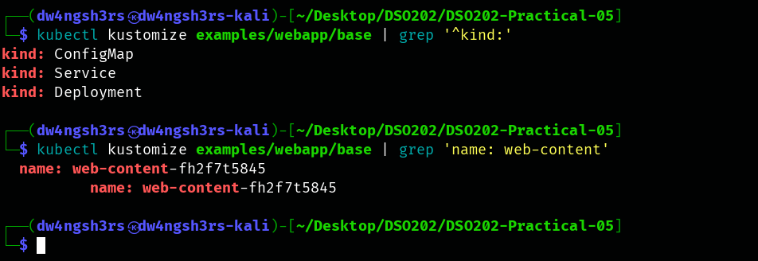

**Observation:** the base renders three objects: a `ConfigMap`, a `Service` and a `Deployment`. It was **not** applied. The ConfigMap was declared as `web-content`, but it rendered as **`web-content-fh2f7t5845`**. The second match is the Deployment's `volumes[].configMap.name`, which Kustomize rewrote to the same hashed name.

**Checkpoint — why the name is not exactly `web-content`:** `configMapGenerator` adds a suffix that is a hash of the ConfigMap's *content*. Each new version of the content therefore gets a new, distinct name, and Kustomize rewrites every reference to it. A Pod template that names the ConfigMap changes whenever the content changes, and that forces a rollout. With a fixed name, editing the ConfigMap would leave running Pods on stale content until something else restarted them. The full rendered base is in `evidence/rendered-base.yaml`.

### Task 3 — Compare dev and prod without touching the cluster

```
kubectl kustomize examples/webapp/overlays/dev  > /tmp/webapp-dev.yaml
kubectl kustomize examples/webapp/overlays/prod > /tmp/webapp-prod.yaml
diff -u /tmp/webapp-dev.yaml /tmp/webapp-prod.yaml || true
```

The full 119-line unified diff is saved in `evidence/dev-vs-prod.diff`. The screenshot keeps only the changed lines:

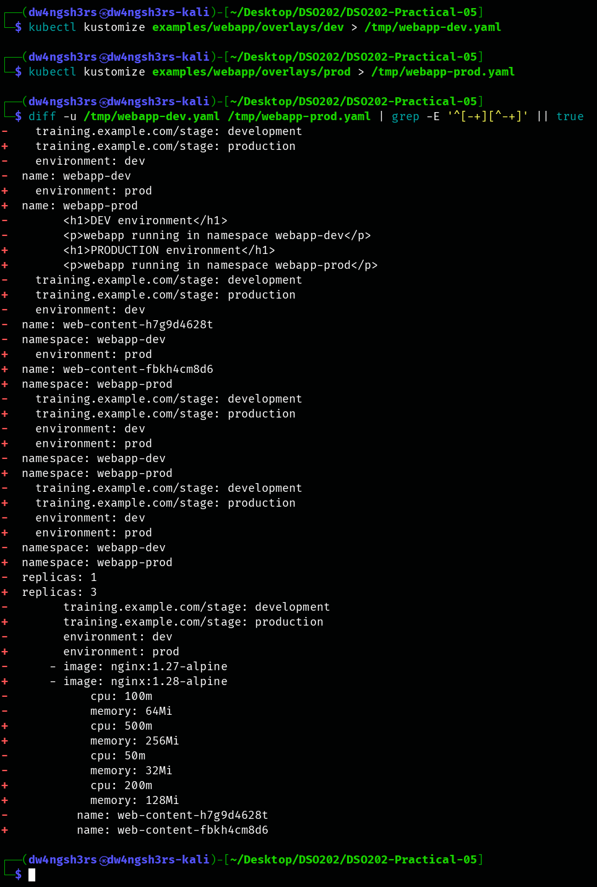

**Seven environment differences identified:**

| # | Category | dev | prod |
|---|---|---|---|
| 1 | Namespace | `webapp-dev` | `webapp-prod` |
| 2 | Environment label | `environment: dev` | `environment: prod` |
| 3 | Replica count | `1` | `3` |
| 4 | Image transformation | `nginx:1.27-alpine` | `nginx:1.28-alpine` (`images:` `newTag`) |
| 5 | Resources (requests / limits) | `50m/32Mi` / `100m/64Mi` | `200m/128Mi` / `500m/256Mi` (patch) |
| 6 | Generated web content | "DEV environment" → `web-content-h7g9d4628t` | "PRODUCTION environment" → `web-content-fbkh4cm8d6` |
| 7 | Annotation | `training.example.com/stage: development` | `training.example.com/stage: production` |

**Observation:** every difference can be traced to a few lines in one overlay, as the lab's principle says. The resource names (`webapp`) and the selectors are identical, because they come from the shared base.

### Task 4 — Deploy dev safely

**Render** (Deployment excerpt of the dev overlay):

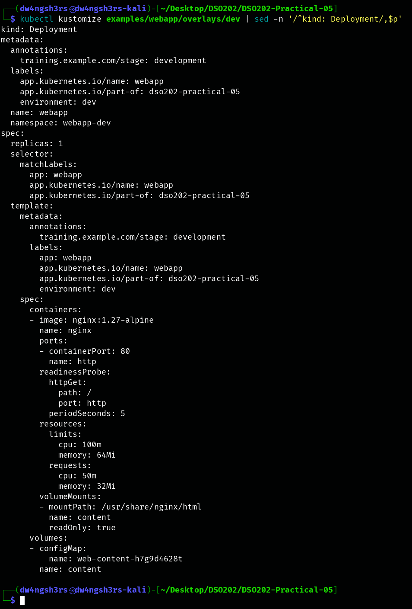

The rendered Deployment keeps the base name `webapp`. It gains `namespace: webapp-dev`, the `environment: dev` label (on the object **and** in the Pod template), `replicas: 1`, and the hashed ConfigMap reference `web-content-h7g9d4628t`.

**Diff, then apply:**

```
kubectl diff -k examples/webapp/overlays/dev || true
kubectl apply -k examples/webapp/overlays/dev
```

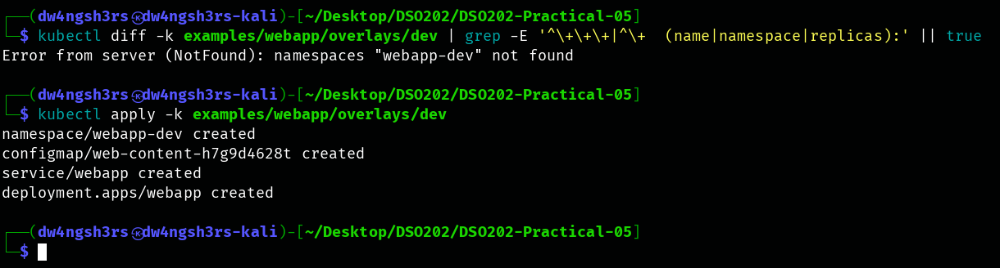

**Observation:** on this first deployment, `kubectl diff` stopped with `Error from server (NotFound): namespaces "webapp-dev" not found`. Diff is a server-side dry-run, and the API server cannot dry-run namespaced objects into a namespace that does not exist yet. That is why the lab writes `|| true`. For a brand-new environment the review step is the rendered output (`kubectl kustomize`). `kubectl diff` is only useful once the namespace exists. Apply then created the Namespace, the hashed ConfigMap, the Service and the Deployment in one step.

**Verify:**

```
kubectl get all -n webapp-dev
kubectl get configmap -n webapp-dev
kubectl rollout status deployment/webapp -n webapp-dev
```

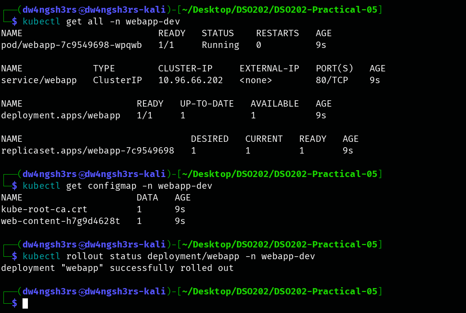

**Observation:** one Pod is `Running 1/1`, the `webapp` ClusterIP Service exists, and the Deployment and ReplicaSet are `1/1`. The only application ConfigMap is `web-content-h7g9d4628t`. The Deployment keeps the base resource name `webapp`. Only the namespace separates the environment.

### Task 5 — Reach the application

```
kubectl port-forward -n webapp-dev service/webapp 8080:80
curl http://127.0.0.1:8080
```

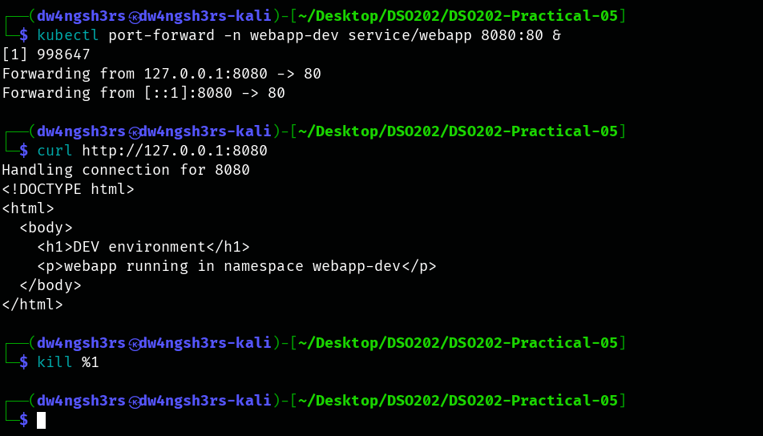

**Observation:** the response is the dev overlay's page (`<h1>DEV environment</h1>`, "namespace webapp-dev"). The content came from the overlay's generated ConfigMap mounted at `/usr/share/nginx/html`, which confirms the overlay replaced the base page. The port-forward was stopped afterwards (`kill %1`).

### Task 6 — Prove the ConfigMap hash/rollout chain

**Before** the change:

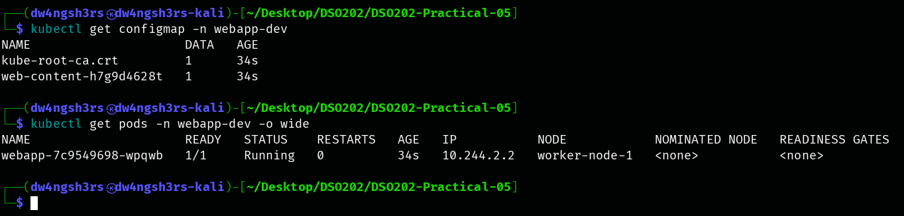

`examples/webapp/overlays/dev/index.html` was then edited to `<h1>DEV v2 — configuration changed</h1>`, rendered again **before applying**, and applied:

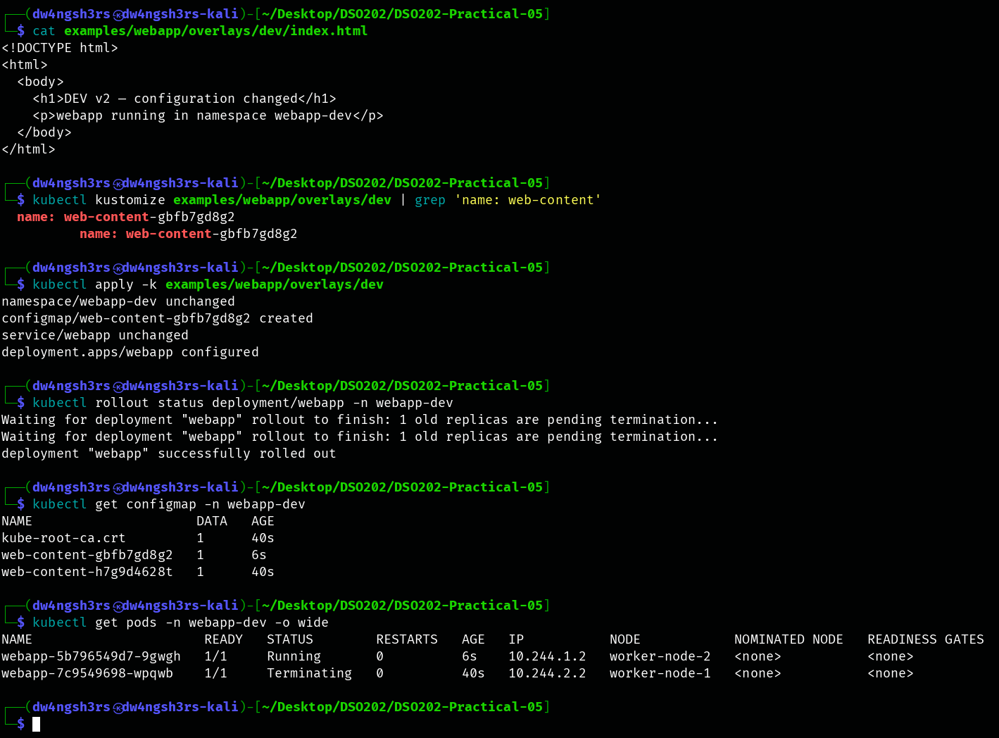

| | Before | After |
|---|---|---|
| Generated ConfigMap | `web-content-h7g9d4628t` | `web-content-gbfb7gd8g2` |
| ReplicaSet (pod-template hash) | `webapp-7c9549698` | `webapp-5b796549d7` |
| Pod | `webapp-7c9549698-wpqwb` (worker-node-1) | `webapp-5b796549d7-9gwgh` (worker-node-2) |

**The chain, in my own words:**

```
file content changed            index.html in the dev overlay was edited
→ generated ConfigMap content changed     configMapGenerator re-read the file
→ generated ConfigMap name hash changed   h7g9d4628t → gbfb7gd8g2 (seen in the render, before apply)
→ Deployment reference changed            volumes[].configMap.name rewritten to the new name
→ Deployment pod template changed         the template now differs, so its template hash differs
→ rollout occurred                        new ReplicaSet 5b796549d7 created; old Pod Terminating
```

**Observation:** `kubectl apply` reported `configmap/web-content-gbfb7gd8g2 created` and `deployment.apps/webapp configured`, while the namespace and Service were `unchanged`. Nobody edited the Deployment by hand. The change reached it only through the rewritten reference. The **old** ConfigMap `web-content-h7g9d4628t` is still present, because `kubectl apply` does not prune. That keeps the previous ReplicaSet's content available for a `kubectl rollout undo`.

### Task 7 — Deploy staging and prod

```
kubectl apply -k examples/webapp/overlays/staging
kubectl apply -k examples/webapp/overlays/prod
kubectl get deploy -A -l app.kubernetes.io/name=webapp
kubectl get pods  -A -l app.kubernetes.io/name=webapp -o wide
kubectl diff -k examples/webapp/overlays/prod      # after apply: drift check
```

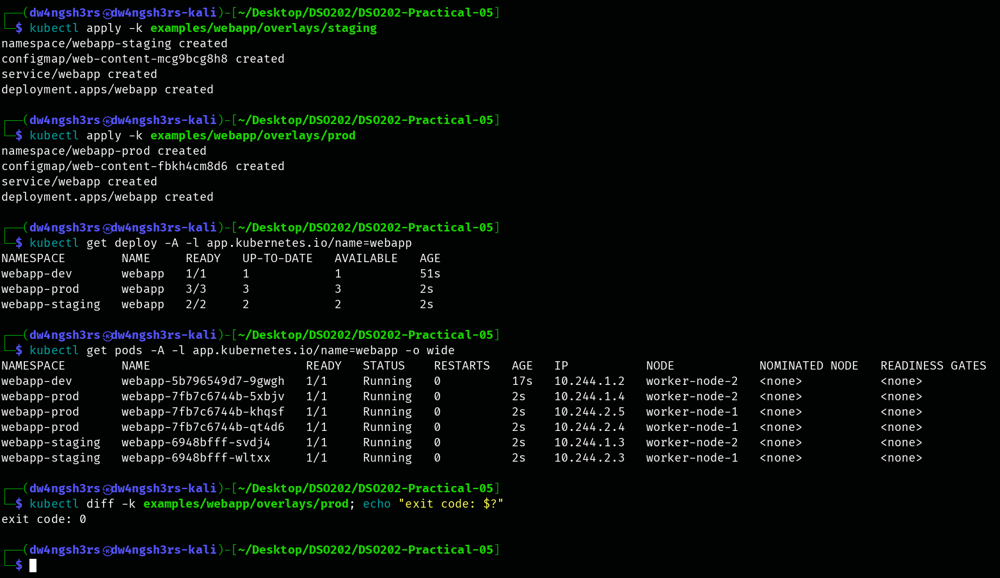

**Replica counts recorded:**

| Environment | Namespace | Replicas (READY) |
|---|---|---|
| dev | `webapp-dev` | 1 (1/1) |
| staging | `webapp-staging` | 2 (2/2) |
| prod | `webapp-prod` | 3 (3/3) |

**Observation:** the same Deployment name `webapp` runs in three namespaces at three different scales, and the Pods are spread across `worker-node-1` and `worker-node-2`. The `app.kubernetes.io/name=webapp` label from the base let one query find every environment. The pre-apply `kubectl diff` would have hit the same missing-namespace error as Task 4, so it was run **after** applying instead. `kubectl diff -k …/prod` printed nothing and exited `0`, which means the live cluster matches the rendered overlay exactly (no drift).

### Task 8 — Inspect what the prod patch changed

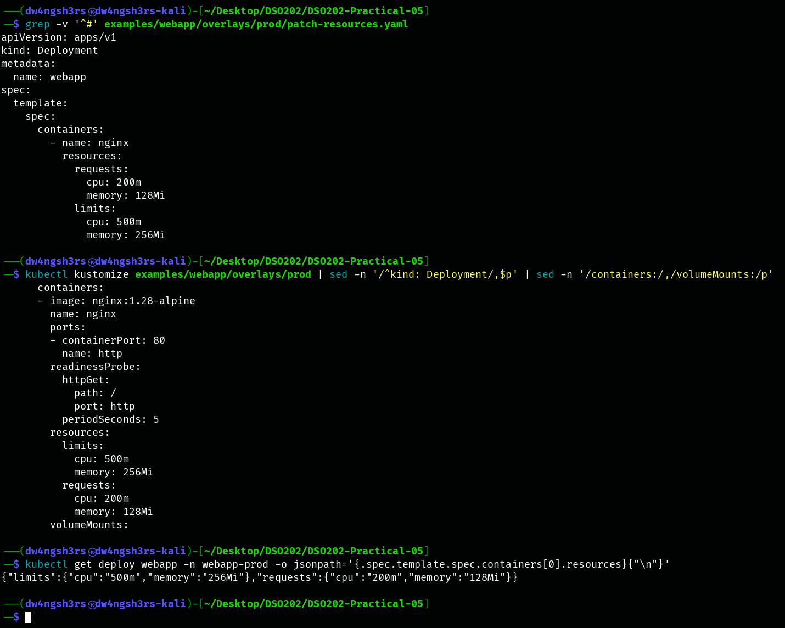

**Observation:** `patch-resources.yaml` lists only `metadata.name`, the container `name: nginx` and its `resources`. In the rendered and live Deployment, the container still has its base image (retagged to `1.28-alpine`), port, readiness probe and volume mount, and its resources became `requests 200m/128Mi, limits 500m/256Mi`.

1. **Were the base resource values deleted entirely or merged?** Merged. A strategic-merge patch matches the container by its merge key (`name: nginx`) and overlays only the fields it lists. The base `requests`/`limits` values were *overwritten field by field*, and every container field the patch did not mention was kept from the base. Nothing outside `resources` was removed.
2. **Which environment owns the production-specific resource policy?** Only **prod**. The patch lives in `overlays/prod/` and is listed only in prod's `kustomization.yaml`. Dev, staging and QA still render the base values (`50m/32Mi`, `100m/64Mi`).
3. **Why is a patch better than copying `deployment.yaml` into `prod/`?** A copy would duplicate about 45 lines to change 6. Any later fix to the base (a probe, a port, a security setting) would then have to be repeated in prod by hand, or prod would silently drift from the other environments. The patch states *only the intent* ("prod needs more CPU/memory"), is easy to review, and keeps inheriting every other base change automatically.

### Task 9 — Create my own QA overlay

Requirements met: namespace `webapp-qa`, replicas `2`, label `environment: qa`, a unique `index.html`, the same base, an owner annotation added by a **JSON 6902** patch, and no copied `deployment.yaml` or `service.yaml`.

**QA overlay files:**

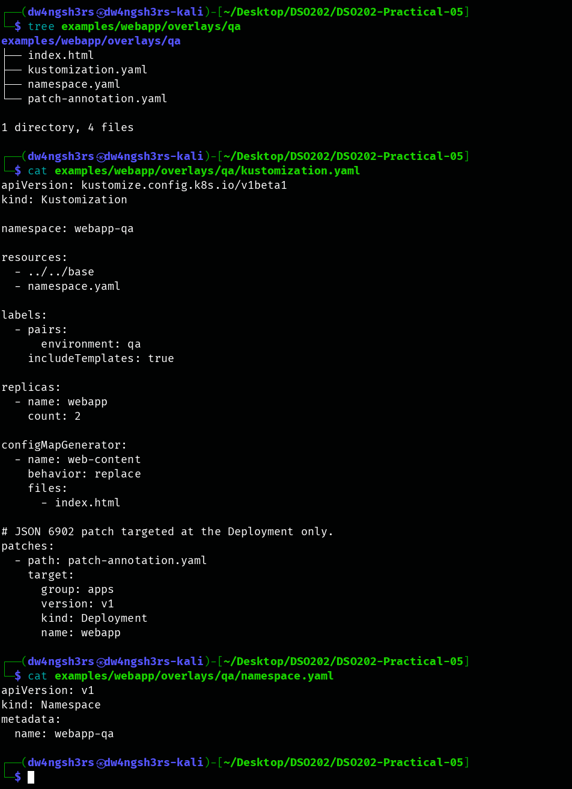

**My mistake, and the corrected patch:**

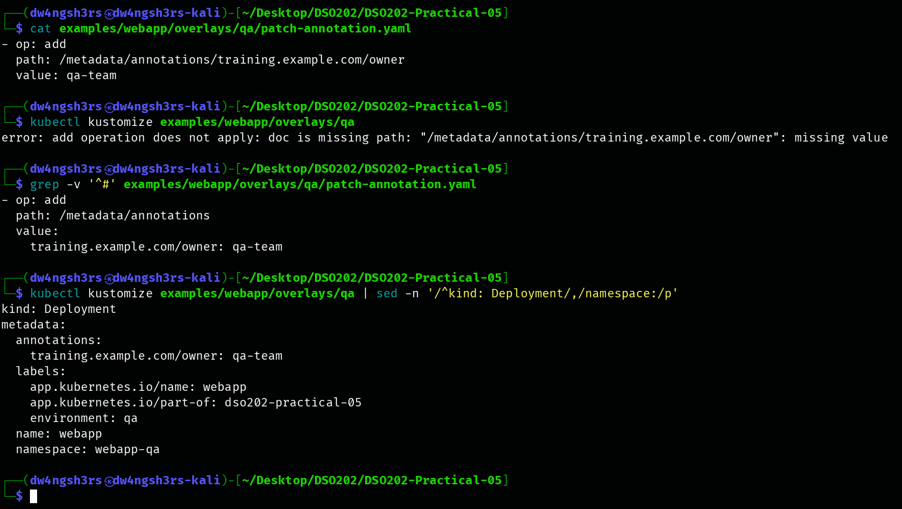

My first patch addressed the annotation key directly in the path: `/metadata/annotations/training.example.com/owner`. JSON Pointer treats every `/` as a path separator, so it read this as an annotation `training.example.com` containing a child `owner`. `kubectl kustomize` refused to render it (`doc is missing path … missing value`). The fix was to add the whole `annotations` map at `/metadata/annotations` (the base Deployment has none). Writing the `/` inside the key as `~1` would also have worked. After the fix, the rendered Deployment showed `training.example.com/owner: qa-team`. Only then did I continue, as the lab instructs.

**Diff, apply, verify:**

```
kubectl diff -k examples/webapp/overlays/qa || true
kubectl apply -k examples/webapp/overlays/qa
kubectl get deployment webapp -n webapp-qa -o yaml
```

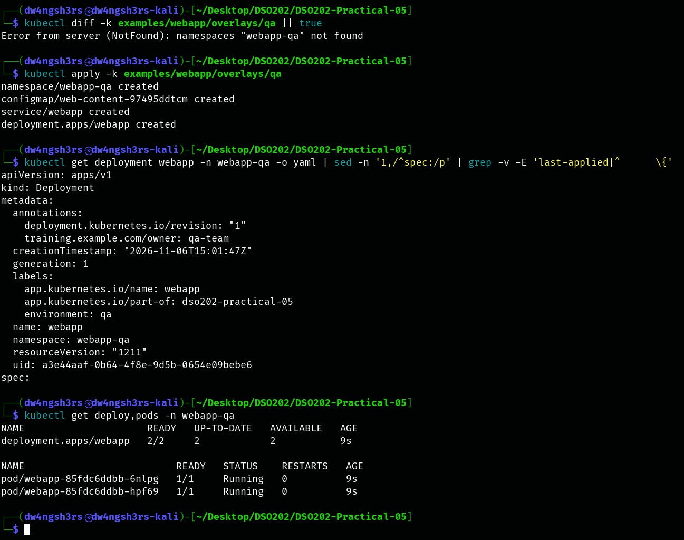

**Observation:** the live Deployment in `webapp-qa` carries `training.example.com/owner: qa-team` with `environment: qa`, and `2/2` Pods are running. The annotation is on the **Deployment only** (the patch `target` selects `kind: Deployment, name: webapp`), not on the Service or ConfigMap. The full live object is saved in `evidence/qa-deployment.yaml`.

### Task 10 — Cleanup

```
kubectl delete -k examples/webapp/overlays/dev
kubectl delete -k examples/webapp/overlays/staging
kubectl delete -k examples/webapp/overlays/prod
kubectl delete -k examples/webapp/overlays/qa
kubectl get ns | grep 'webapp-' || true
```

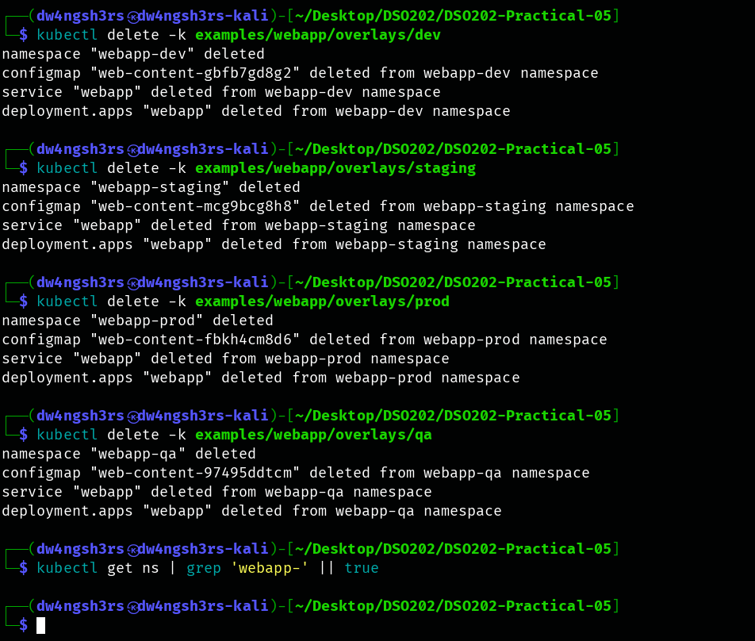

**Observation:** each `delete -k` removed exactly the objects that overlay renders, including its Namespace. The final `grep` printed nothing, so no `webapp-*` namespace remains. `delete -k` for dev named only the *current* ConfigMap (`web-content-gbfb7gd8g2`). The older `web-content-h7g9d4628t` left behind by Task 6 was not in the rendered output, and it was removed only because its namespace was deleted. Without the namespace deletion, `delete -k` would have left the old hashed ConfigMaps behind.

### Challenge extension — `namePrefix` in a sandbox overlay

A new `overlays/sandbox/` adds `namePrefix: sandbox-` and reuses the base unchanged. I wrote my prediction to `PREDICTION.md` **before** rendering:

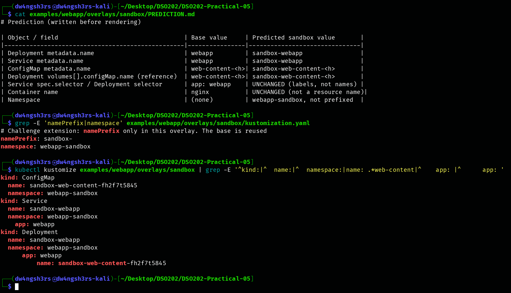

| Field | Predicted | Rendered | Match |
|---|---|---|---|
| Deployment name | `sandbox-webapp` | `sandbox-webapp` | ✔ |
| Service name | `sandbox-webapp` | `sandbox-webapp` | ✔ |
| ConfigMap name | `sandbox-web-content-<hash>` | `sandbox-web-content-fh2f7t5845` | ✔ |
| Deployment → ConfigMap reference | `sandbox-web-content-<hash>` | `sandbox-web-content-fh2f7t5845` | ✔ |
| Selectors (`app: webapp`) | unchanged | unchanged | ✔ |
| Container name `nginx` | unchanged | unchanged | ✔ |
| Namespace | `webapp-sandbox`, not prefixed | `webapp-sandbox` | ✔ |

**Observation:** the prefix is *reference-aware*. Kustomize renamed the ConfigMap and also rewrote the Deployment's `volumes[].configMap.name` to the prefixed name, so the Pod would still find its content. A plain text search-and-replace could not do that safely. Labels and selectors are not names, so they were left alone, and the Service still selects the Deployment's Pods. The hash suffix (`fh2f7t5845`) is identical to the base's, because the content is the same; the prefix is added in front of the hashed name. The sandbox was rendered only and never applied (`evidence/rendered-sandbox.yaml`).

---

## 4. Analysis

**1. Strategic merge patch vs JSON 6902 patch.**

| | Strategic merge (prod `patch-resources.yaml`) | JSON 6902 (QA `patch-annotation.yaml`) |
|---|---|---|
| Form | A partial Kubernetes object with the same shape as the target | A list of operations (`add`, `replace`, `remove`, `move`, `copy`, `test`) |
| How it finds the target | `apiVersion`/`kind`/`metadata.name` inside the patch | An explicit `target:` selector in `kustomization.yaml` |
| How it addresses fields | By structure; list items are matched by **merge keys** (for example a container's `name`) | By an exact **JSON Pointer path** (`/metadata/annotations`); list items by **index** |
| Strengths | Readable and safe for lists of named items. It reads like "the parts of the YAML that are different" | Precise and explicit. It can *remove* fields or replace whole values, works on any resource (including CRDs without merge metadata), and fails loudly when a path is wrong |
| Weaknesses | Removing a field needs special directives (`$patch: delete`); custom resources may not have merge keys | Paths are brittle (index positions shift, and `/` in keys must be escaped as `~1`); harder to read |

In this practical, strategic merge suited prod. Changing one named container's `resources` while keeping everything else is exactly what merge keys exist for. JSON 6902 suited QA, where a single exact `add` operation on a known path was required. My first QA patch also showed that JSON 6902 is strict: a wrong path is an error, not a silent no-op.

**2. Why the generated ConfigMap name carries a hash.** The name is derived from the content, so a content change produces a new object name. That changes the Deployment's Pod template and starts a normal, controlled rolling update, which Task 6 demonstrated end to end. The old ConfigMap stays in place, so a rollback to the previous ReplicaSet still has its matching content.

**3. Why the safe workflow is render → diff → apply → verify.** Each step catches a different class of error before the next one runs. Rendering caught my QA path mistake with zero cluster impact. The diff confirmed prod had no drift after deployment. Apply changed only what the diff showed. Verify (`rollout status`, `get`, `curl`) proved the result actually worked. The practical also showed the limit of `kubectl diff`: it cannot diff into a namespace that does not exist yet, so for a brand-new environment the rendered output is the review.

---

## 5. Reflection

**The Kustomize mistake I made and how rendered output exposed it.** In the QA overlay I first wrote the JSON 6902 path as `/metadata/annotations/training.example.com/owner`. I was thinking of the annotation key as a single string, but JSON Pointer reads every `/` as another level, so the patch pointed at a nested `owner` field under a non-existent `training.example.com` key. Running `kubectl kustomize examples/webapp/overlays/qa` *before* any `apply` failed immediately with `add operation does not apply: doc is missing path`. The mistake never reached the cluster. I fixed it by adding the whole `/metadata/annotations` map, and I learned that a `/` inside a key must be written as `~1` when it appears in a path. The lab's rule "do not proceed until the annotation appears in the rendered Deployment" is exactly the check that caught it.

The most useful part of the practical was Task 6. Watching one edited HTML line become a new ConfigMap name, a new ReplicaSet hash and a replaced Pod, without touching the Deployment at all, made the purpose of the hash suffix concrete. If I repeated the practical, I would create the namespaces before the first `kubectl diff` (or apply the Namespace alone first) so that the diff step also produces a useful preview for brand-new environments.
